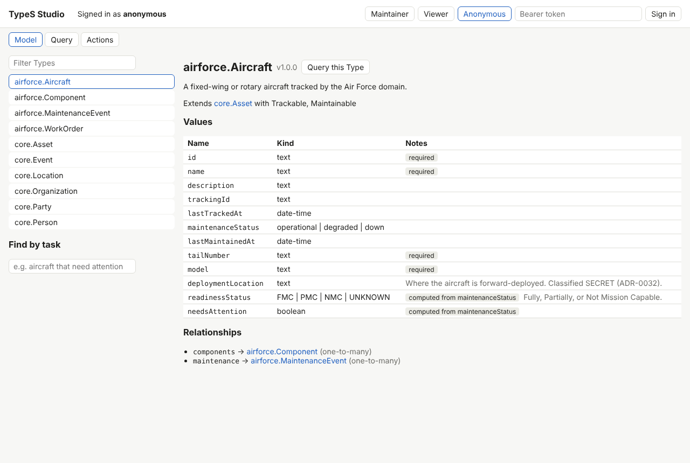
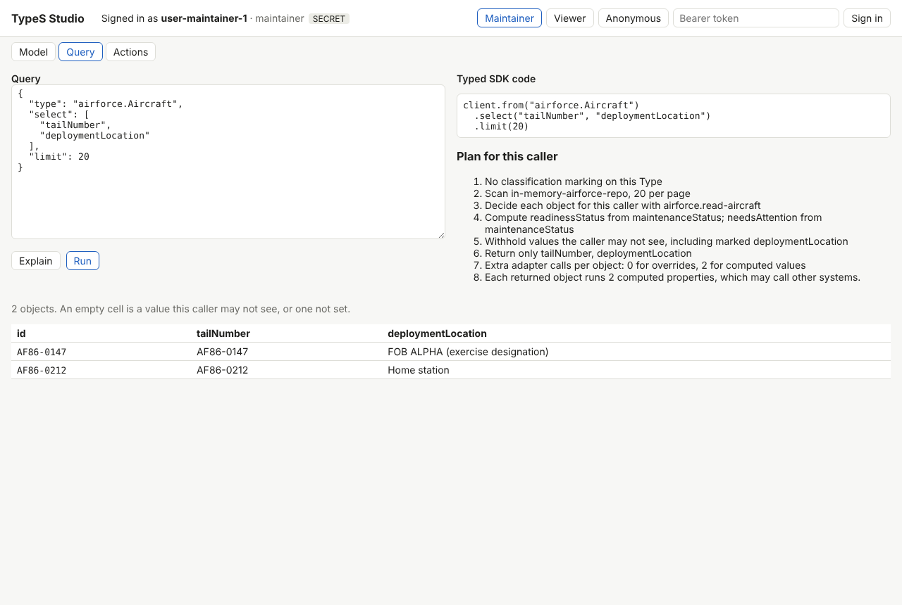
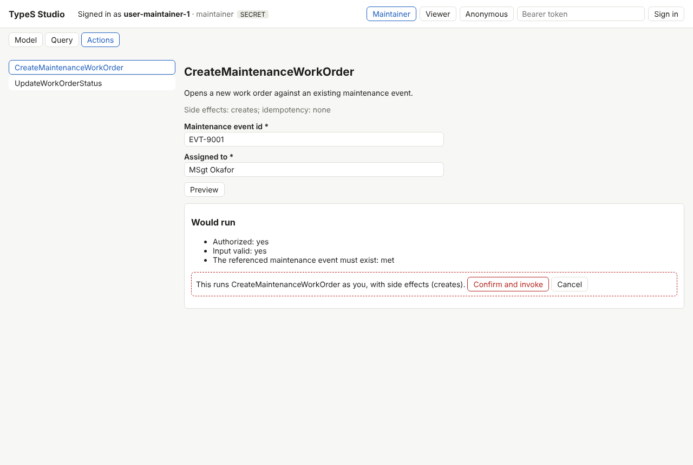

# TypeSys Studio against the baseline, 2026-10-13

Slice 9 of the [roadmap](../roadmap.md), [ADR-0061](../adr/0061-typesys-studio.md).
Compared with [`baseline-2026-10-13.md`](baseline-2026-10-13.md), where
the model, queries and Actions could be tried only from code, the MCP
inspector or the demo console's fixed screens.

## What a person can now do without writing code

| Before | Now | Shown in |
|---|---|---|
| Read a domain's TypeScript or YAML to learn its Types | The Model screen: composed values, computed values and what they derive from, relationships, Actions, discovery by task |  |
| Write a query, run it, read the error | The validator's diagnostics as it is typed, a suggested name applied with one click, Run disabled while there is an error | `browser.test.ts`: "fixes, explains and codes a query" |
| Ask a developer what a query will cost | The execution plan for the signed-in caller, as sentences |  |
| Translate a working query into application code by hand | The typed SDK code that builds the same query, checked over 2,000 generated queries | `source.test.ts` |
| Ask an administrator what another role sees | Sign in as them: the same screen, the runtime's answer for that token | `browser.test.ts`: the viewer's `deploymentLocation` cells are empty, the maintainer's are not |
| Invoke an Action to find out whether it is allowed | A preview first; Invoke only for the previewed input, after a confirmation naming its side effects |  |

The screenshots are the browser test's own, taken with
`STUDIO_SCREENSHOTS=docs/evidence/studio`.

## What it is made of

The Studio is 1,013 lines: a 65-line server, 136 lines of screen logic,
a 51-line API client, five React components (670 lines), the page
and its stylesheet. Each screen is a capability that already existed:

| Screen | Built on |
|---|---|
| Model | `GET /api/model` (ADR-0056), `columnsFor` (ADR-0058), `POST /api/discover` |
| Query | `POST /api/query/validate`, `/query/explain` (ADR-0054), `/query`, and the new `querySource` (64 lines in the SDK) |
| Actions | `formFields`, `coerceForm` (ADR-0058), `/actions/:name/preview` (ADR-0053), `/invoke` |

The only additions outside the package are `querySource`, `httpCall`
(extracted from `httpTransport`, not new behavior) and `GET /me`.

## What it costs

The bundle is one script of 165.7 KB, 53.4 KB gzipped (React, React DOM,
the SDK and `@typesys/react`), built by `esbuild` in about 0.6 s.

Each screen action is one API call by the signed-in person. 500 calls of
each after 50 warm-up calls, Node 22, in-memory sources with no simulated
latency, the Studio app on loopback in the same process, viewer token,
query filtered on a stored and a computed value. Two runs:

| Call | p50 | p95 |
|---|---|---|
| validate (each edit, debounced by 250 ms) | 1.55, 1.60 ms | 2.38, 2.77 ms |
| explain | 1.36, 1.53 ms | 1.85, 2.63 ms |
| query | 1.23, 1.37 ms | 1.57, 2.00 ms |
| model (on sign-in) | 1.08, 1.12 ms | 1.58, 1.56 ms |

Validation describes the model on every call. At these sizes that is not
worth caching; a much larger model may make it so.

## Security checks

- Every response under the Studio carries a Content Security Policy of
  `default-src 'none'` with only `'self'` for script, style, images and
  API calls, and `frame-ancestors`, `base-uri` and `form-action` closed.
  The browser test fails on any console error, so a resource the policy
  blocked would fail it.
- The token is held in `sessionStorage` and sent only as a bearer header
  to the same origin.
- A request with another site's `Origin` is refused by the API's own
  guard (ADR-0058).

## Mutation check

21 mutations, each caught by at least one test; ADR-0061 lists them. Five
are in the browser client and were caught only by the browser test,
including invoking an input other than the one previewed. Two further
`querySource` mutants are equivalent and are explained there.

## Not shown

The Studio was exercised in Chromium only, with the airforce demo. No
usability study was run, and there is no sign-in flow beyond pasting a
token. Whether it shortens building an application is slice 10's
comparison, not a claim made here.
