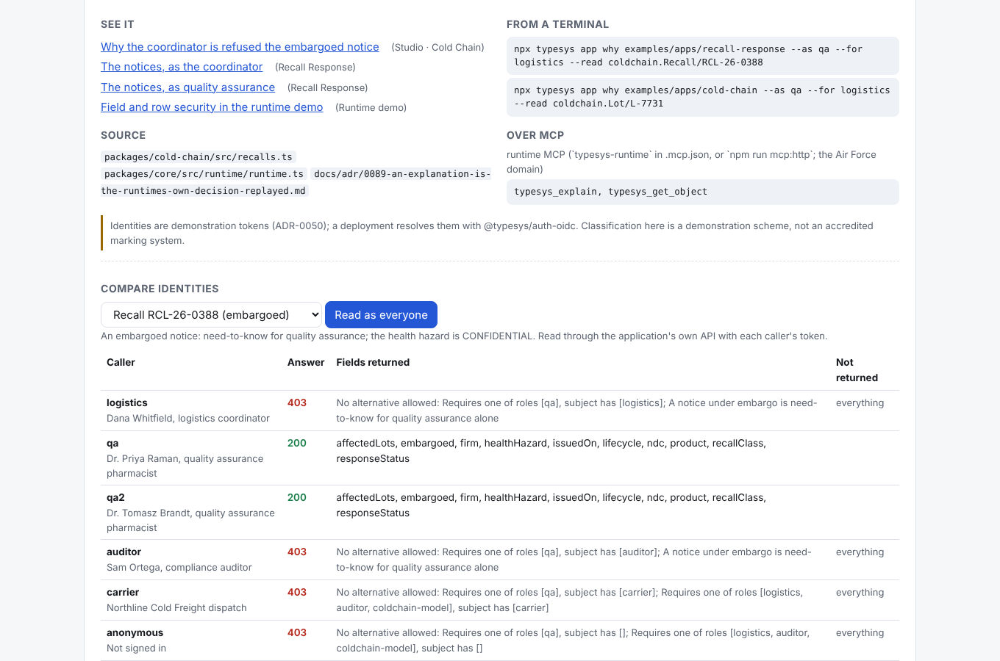
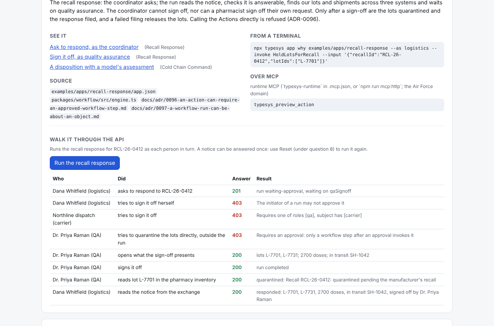
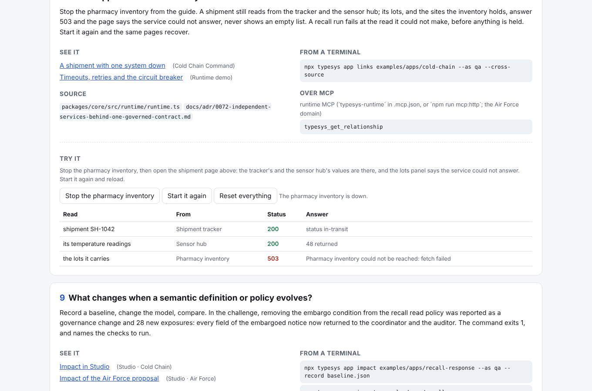
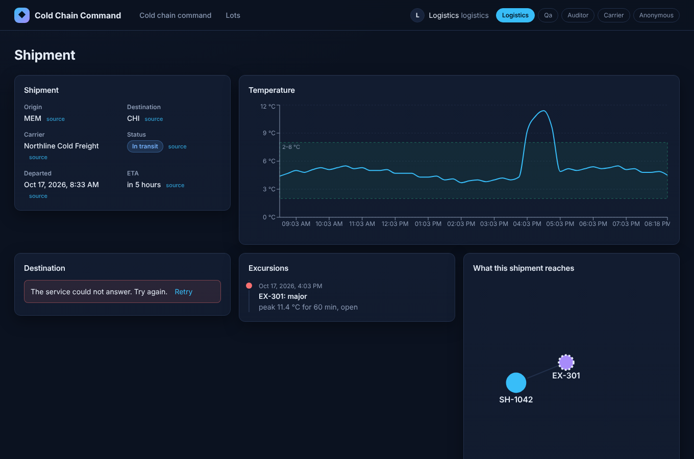

# The TypeSystem developer showcase

One command starts everything TypeSystem demonstrates, over the same independent services, and a guide that answers ten engineering questions on the running surfaces, each with the terminal command and MCP tool that answer it without a browser.

```bash
npm install && npm run build
npx typesys app build examples/apps/cold-chain
npx typesys app build examples/apps/recall-response
npm run showcase                      # then open http://127.0.0.1:4300
```

`npm run showcase -- check` says what is missing (a build, a busy port) and what to run, without starting anything. Ctrl-C stops every process it started.

## What starts

| Port | Surface | What it is |
| --- | --- | --- |
| 4300 | Showcase guide | The ten questions, a live identity comparison, an outage switch, the workflow walk and the model configuration |
| 4000 | Runtime demo | The Air Force and hospital domains, as each identity, with both policy engines |
| 4400 | Studio · Air Force | The semantic workbench: model, graph, explanations, impact, queries, Actions |
| 4401 | Studio · Cold Chain | The same workbench over four systems, with both cold-chain applications in its graph |
| 4700 | Cold Chain Command | The compiled 4.0 reference application over three systems |
| 4710 | Recall Response | The application built in the [challenge](../evidence/showcase-challenge/README.md), over four systems |
| 4801–4804 | Shipment tracker, sensor hub, pharmacy inventory, recall exchange | Independent plain-Node services with their own data and authentication (API key, OAuth client credentials, operations key, HTTP Basic) |
| 4790 | Simulated model | An OpenAI-compatible endpoint that answers deterministically and says so ([models.md](models.md)) |

Every surface reads the same four services, so a lot quarantined in Recall Response is quarantined in Cold Chain Command and in Studio, and stopping a service is an outage for all of them. Links from the guide sign the surface in as a named demonstration person (`?as=qa` on an application, `#as=QA` in Studio), so each question opens on the view that answers it.

The identities are demonstration tokens and the classification scheme is a demonstration one. Nothing here is an accredited security configuration; a deployment resolves identities with `@typesys/auth-oidc` and keeps its own markings.

## The ten questions

The guide asks them in this order; [coverage.md](coverage.md) lists every link, command, MCP tool and source file, and is generated from the same catalog the guide renders (`packages/showcase/src/catalog.ts`).

1. What systems are connected?
2. What business objects and capabilities do they represent?
3. How are objects related across systems?
4. What can each identity see and do?
5. Where does the information originate?
6. How can applications and Claude Code use these capabilities?
7. How does a governed workflow operate?
8. What happens when a source system fails?
9. What changes when a semantic definition or policy evolves?
10. How does TypeSystem identify regressions and security consequences?

## A verified walkthrough

These are the answers the guide's live panels gave on a fresh start, on 2026-10-17; the browser test (`packages/showcase/test/launch.test.ts`) asserts each of them.

**Question 4: the embargoed notice RCL-26-0388, read through Recall Response's own API as each caller.** Both pharmacists are returned all ten fields, including the CONFIDENTIAL `healthHazard`. The coordinator and the auditor get 403 with the reason "A notice under embargo is need-to-know for quality assurance alone"; the carrier and an anonymous caller get 403 because neither role may read notices at all. The public notice RCL-26-0412 returns nine fields to the coordinator and the auditor, without `healthHazard`.



**Question 7: the recall response for RCL-26-0412, walked through the API.**

| Who | Did | Answer |
| --- | --- | --- |
| Dana Whitfield (logistics) | asks to respond | 201, waiting on `qaSignoff` |
| Dana Whitfield | tries to sign it off herself | 403, the initiator of a run may not approve it |
| Northline dispatch (carrier) | tries to sign it off | 403, requires role qa |
| Dr. Priya Raman (QA) | invokes `HoldLotsForRecall` directly | 403, requires an approval (ADR-0096) |
| Dr. Priya Raman | opens the sign-off | lots L-7701, L-7731; 2,700 doses; in transit SH-1042 |
| Dr. Priya Raman | signs it off | 200, run completed |
| | lot L-7701 in the pharmacy inventory | quarantined: "Recall RCL-26-0412: quarantined pending the manufacturer's recall" |
| | the notice in the exchange | responded, 2,700 doses, signed off by Dr. Priya Raman |



**Question 8: the pharmacy inventory stopped.** Shipment SH-1042 still reads from the tracker (200) and its 48 readings from the sensor hub (200); its lots answer 503, "Pharmacy inventory could not be reached", rather than an empty list. Started again, the lots return.



The application's own page for SH-1042 says the same: the tracker's and sensor hub's values are there, and the panels the inventory feeds say the service could not answer. A recall run started during the outage fails at its inventory step, before anything is held.



**Question 6: the runtime model.** Cold Chain Command runs with `llm/simulated.json`. An assessment of excursion EX-299 through the OpenAI-compatible provider path returned `release`, confidence high, "30 minutes at a peak of 8.6 °C is within the 120-minute stability budget. (simulated model)", and the endpoint counted one request.

## Claude Code in the showcase

Claude Code is the developer here, not a feature of the runtime. The repository registers three MCP servers for it in [`.mcp.json`](../../.mcp.json): `typesys-app` (context, check, compile, build, verify, impact for `app.json` applications), `typesys-onboard` (proposals from a source's metadata) and `typesys-runtime` (governed reads, previews and Actions over the Air Force domain, each call carrying its caller's token).

The recall-response challenge is the record of Claude Code using them on a task it had not seen, with the requirement and hidden checks written first by someone else. The transcripts are real session logs, not reconstructions; [the report](../evidence/showcase-challenge/README.md) gives the timings, the comparison with and without the tools, and what the run does not show.

To run the challenge yourself, build a sealed copy of the repository with the solution and the hidden checks withheld, start Claude Code in it, and score what it builds:

```bash
node packages/evaluation/dist/bin.js sandbox --task recall-response --arm agent-with --out /tmp/recall
# In /tmp/recall: read BRIEF.md, REQUIREMENT.md and CONTRACT.md, build app/
node packages/evaluation/dist/bin.js score --task recall-response --arm agent-with \
  --dir /tmp/recall/app --source agent --producer "your name"
```

`--arm agent-without` gives the baseline's narrower set of packages. Nothing in either path calls a paid API.

## Tests

`packages/showcase/test/catalog.test.ts` and `models.test.ts` run on every pull request: every file the catalog names exists, every MCP tool it names is registered, `coverage.md` matches the catalog, the simulated and real configurations are labelled as such and never print a key, and the simulated endpoint answers through `@typesys/llm`'s discovery and validation. `launch.test.ts` starts the whole showcase and drives it in Chromium; it starts eleven servers, so it runs locally (`npm test` with Chromium present) and never on a pull request's CI. `TYPESYS_SHOWCASE_SCREENSHOTS=1` makes it save the screenshots in `docs/images/showcase/`.
